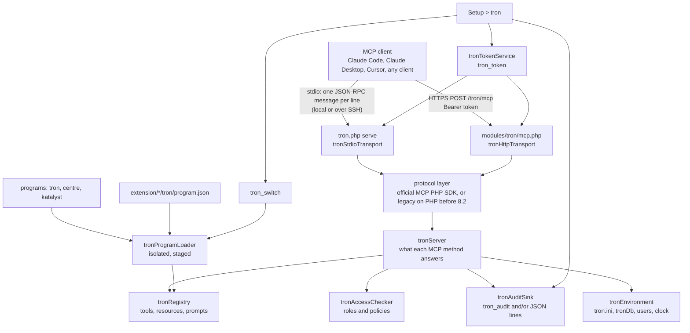

# Exponential Tron

**The MCP server layer of Exponential.** Exponential Tron takes what an ordinary MCP connector offers and gives it an edge a
content platform can trust: an AI agent works inside your Exponential installation as one of its real users, under that
user's roles and policies, through a token of its own, with every call written to an audit log. You decide which
programs and tools exist, who may call them and for how long, and you can see everything that happened. The agent does
the work; the control stays with you.


[](https://packagist.org/packages/se7enxweb/tron)

> **Preview.** Exponential Tron is public since 0.0.0.12, and built and proven on a development installation (every PHP
> from 7.4 to 8.5, proving runs through PHP-FPM, Velocity and a load balancer; see [doc/testing.md](doc/testing.md)).
> Interfaces may still change between preview releases.

## Contents

- [Why Exponential Tron](#why-exponential-tron)
- [Features](#features)
- [Quick start in 5 minutes](#quick-start-in-5-minutes)
- [Connecting clients](#connecting-clients)
- [The HTTP transport](#the-http-transport)
- [Programs and tools](#programs-and-tools)
- [Use cases](#use-cases)
- [Security model](#security-model)
- [Administration: Setup > tron](#administration-setup--tron)
- [Configuration](#configuration)
- [Command line](#command-line)
- [Writing a program](#writing-a-program)
- [Skills and skill packs](#skills-and-skill-packs)
- [Architecture](#architecture)
- [Several sites, clusters, hosting](#several-sites-clusters-hosting)
- [Performance](#performance)
- [Compatibility](#compatibility)
- [Troubleshooting and FAQ](#troubleshooting-and-faq)
- [Development and testing](#development-and-testing)
- [Versioning and upgrading](#versioning-and-upgrading)
- [Roadmap](#roadmap)
- [Contributing](#contributing)
- [Documentation](#documentation)
- [License](#license)

## Why Exponential Tron

Most MCP connectors sign in once with a single service account, expose a fixed list of tools, and leave you to trust
whatever the agent does with them. Exponential Tron starts where they stop:

| | A typical MCP connector | Exponential Tron |
|---|---|---|
| **Identity** | one shared account for every agent | every call runs as a real Exponential user, with that user's roles and policies |
| **Permissions** | all tools for everyone, or a separate list to maintain | the installation's own policies decide; an agent sees only what its user may call |
| **Credentials** | a long-lived key in a configuration file | per-agent tokens: hashed, expiring, scoped to programs, rotated and revoked in one step |
| **What is offered** | fixed at build time | programs found in your extensions; any program or tool switched on or off per installation |
| **Accountability** | the client's own logs, if any | every call audited with user, token, outcome and time; writes logged *before* they run; a live tail |
| **Operations** | edit files and restart | Setup > tron in the administration, settings in the INI system like the rest of the installation |
| **Ways in** | usually one | stdio (local or over SSH) and streamable HTTP, side by side |

The result: you can give an agent real work in a live installation, and still say exactly who it is, what it may do,
until when, and what it did.

## Features

- **Real users, real policies.** Exponential Tron has no permission system of its own. Every tool names an Exponential policy
  (`tron/centre_write`, ...); the kernel's `eZUser::hasAccessTo` decides on every call, and `tools/list` shows exactly
  what the user may call.
- **Search as the user.** `search_query` runs the installation's own search engine (the built-in engine or eZ Find)
  with subtree, class, section and language filters, sort, paging and facets where the engine counts them; the
  user's content/read policies are the search's limitation, so nothing the user may not read is found or counted.
  `search_index` shows the engine, the indexing queue and whether an object is indexed.
- **Per-agent tokens.** `tron_<prefix>_<secret>`: 256 random bits, stored only as a SHA-256 hash, shown once, with an
  expiry (90 days by default, at most 365), program scopes, one-step rotation and immediate revocation. Disabling a
  user stops all of that user's tokens.
- **Two transports.** stdio for agents on the server or over SSH (nothing listens); stateless streamable HTTP at
  `/tron/mcp` for agents elsewhere, behind any load balancer, no stickiness.
- **Complete audit.** Every `tools/call`, `resources/read`, `prompts/get`, refused sign-in and administration token
  action, in a table and/or a JSON-lines file, secrets masked. A write tool does not run unless its audit entry was
  written first.
- **Programs by convention.** Drop `tron/program.json` into any extension and its tools appear. Each program loads in
  isolation: a broken one fails alone and says why.
- **Switches.** Any program or tool off or on per installation from Setup > tron, effective on the next request.
- **Administration views.** Dashboard, tokens, programs and tools (with the roles that grant each policy), audit with
  filters and live tail, settings; "Verify it's you" before sensitive actions; light and dark mode; English and German.
- **Settings in the INI system.** `tron.ini` with per-siteaccess overrides, edited through the kernel's INI editor.
- **Built on the official MCP PHP SDK.** On PHP 8.2 and newer, with the package `mcp/sdk` installed, the
  [official SDK](https://github.com/modelcontextprotocol/php-sdk) does the protocol: JSON-RPC, the version
  negotiation, the lifecycle, stdio and streamable HTTP. tron supplies the tools, resources and prompts, the tokens,
  the policies and the audit. On PHP 7.4 to 8.1, where the SDK cannot run, a frozen legacy layer speaks the same
  versions. [doc/protocol.md](doc/protocol.md).
- **MCP 2025-11-25**, plus 2025-06-18, 2025-03-26 and 2024-11-05: tools, resources, resource templates, prompts,
  pagination, `structuredContent`.
- **Few dependencies.** PHP 7.4 to 8.5; MySQL/MariaDB, PostgreSQL and SQLite. The SDK (`mcp/sdk` and a PSR-7
  implementation such as `nyholm/psr7`) is suggested, not required, so an installation on PHP 7.4 to 8.1 still installs.
- **Proven.** A test suite with a per-role permission matrix, MCP conformance over real stdio and HTTP, a cookbook whose
  output is checked byte for byte, and a theory page whose every claim names its test.

## Quick start in 5 minutes

From the installation root. `<sa>` is an administration siteaccess, `<php>` the installation's PHP, `<root>` the
installation root. Run as root, add `--allow-root-user` to every command. The full walk-through:
[doc/quickstart.md](doc/quickstart.md).

**1. Install and activate.**

```bash
composer require se7enxweb/tron                   # or: git clone https://github.com/se7enxweb/tron.git extension/tron
```

```ini
# settings/override/site.ini.append.php
[ExtensionSettings]
ActiveExtensions[]=tron
```

```bash
<php> bin/php/ezpgenerateautoloads.php -e
<php> bin/php/ezcache.php --clear-tag=ini         # where Velocity serves: ./console exp:velocity deploy
<php> extension/tron/bin/php/tron.php install --siteaccess=<sa>     # seven tron_* tables; --dry-run prints the SQL
<php> extension/tron/bin/php/tron.php status  --siteaccess=<sa>     # PASS
```

**2. Make a user for the agent** (never a person's account or the shared administrator) and give it a role with the
policies `tron/use`, `tron/centre_read` and `tron/centre_write`, without limitations.

**3. Make a token.**

```bash
<php> extension/tron/bin/php/tron.php token:create --siteaccess=<sa> --token-file=<your administrator token file> \
      --user=agent-claude --name="claude@laptop" --days=30 --scopes=centre --out=$HOME/.config/tron/agent-claude.token
```

The first token, your own, comes from Setup > tron > Tokens; the command line issues further ones with a token of a
user who holds `tron/admin` (a token for yourself needs only your own).

Written with mode 0600, never printed.

**4. Register it with your client.** Claude Code:

```bash
claude mcp add tron -- <php> <root>/extension/tron/bin/php/tron.php serve \
    --siteaccess=<sa> --token-file=$HOME/.config/tron/agent-claude.token
```

Claude Desktop (`claude_desktop_config.json`) or Cursor (`.cursor/mcp.json`):

```json
{
  "mcpServers": {
    "tron": {
      "command": "<php>",
      "args": ["<root>/extension/tron/bin/php/tron.php", "serve", "--siteaccess=<sa>",
               "--token-file=/home/<you>/.config/tron/agent-claude.token"]
    }
  }
}
```

**5. First calls.** Ask: *"Call tron_whoami and tron_status and tell me what you can do here."*

```json
{"user_id": 3, "login": "agent-claude", "token_id": 1, "scopes": ["centre"], "transport": "stdio", "protocol_version": "2025-11-25"}
```

Then: *"Make a ticket to renew the certificate of www, high priority."* and check it:

```bash
<php> extension/tron/bin/php/tron.php audit:tail --siteaccess=<sa> --limit=10
```

## Connecting clients

| Way in | When | Identity |
|---|---|---|
| stdio on the server | the agent runs on a node | `--token-file` or `TRON_TOKEN` (`--user=<login>` only where an override enables it) |
| stdio over SSH | the agent runs on a machine that may SSH to a node | a token file that stays on the node |
| HTTP | anywhere else | `Authorization: Bearer <token>` |

```bash
# stdio over SSH
claude mcp add tron -- ssh -p <port> -o BatchMode=yes root@<node> \
    "<php> <root>/extension/tron/bin/php/tron.php serve --siteaccess=<sa> --allow-root-user --token-file=/root/.config/tron/<name>.token"

# HTTP
claude mcp add --transport http tron https://<host>/tron/mcp --header "Authorization: Bearer $TRON_TOKEN"
```

Claude Desktop, Cursor, VS Code, any other client, and how to check an entry before a session uses it:
[doc/clients.md](doc/clients.md).

## The HTTP transport

Off until you open it. Stateless: POST in, one JSON answer out; any node can answer any request.

```ini
# settings/override/tron.ini.append.php
[HTTPSettings]
Enabled=true
SiteAccesses[]
SiteAccesses[]=<user-facing siteaccess with RequireUserLogin=false>
AllowedHosts[]
AllowedHosts[]=<host>
```

Then: a global URL alias `mcp -> tron/mcp` for the short address `/mcp`; behind Apache with PHP-FPM,
`SetEnvIf Authorization "(.*)" HTTP_AUTHORIZATION=$1`; behind exp_request_shield, include
[doc/request-shield/tron.rules](doc/request-shield/tron.rules).

```bash
URL=https://<host>/tron/mcp
AUTH="Authorization: Bearer $(cat ~/.config/tron/<name>.token)"

curl -s -X POST "$URL" -H "$AUTH" -H 'Content-Type: application/json' -H 'Accept: application/json, text/event-stream' \
     -d '{"jsonrpc":"2.0","id":1,"method":"initialize","params":{"protocolVersion":"2025-11-25","capabilities":{},"clientInfo":{"name":"curl","version":"1"}}}'

curl -s -X POST "$URL" -H "$AUTH" -H 'Content-Type: application/json' -H 'MCP-Protocol-Version: 2025-11-25' \
     -d '{"jsonrpc":"2.0","id":2,"method":"tools/list"}' | jq -r '.result.tools[].name'
```

| Status | Meaning |
|---|---|
| 200 | the JSON-RPC answer |
| 202 | a notification, accepted |
| 400 | unsupported `MCP-Protocol-Version` |
| 401 | no token, or a malformed, unknown, expired or revoked one, or a disabled user (`WWW-Authenticate: Bearer realm="tron"`) |
| 403 | a foreign `Origin`, or a user without `tron/use` |
| 404 | the endpoint is off for this siteaccess |
| 405 | not POST (Exponential Tron offers no event stream) |
| 413 / 415 / 421 | body too large / not `application/json` / Host not in `AllowedHosts[]` |

Every check in order, version negotiation, errors and browsers: [doc/http-transport.md](doc/http-transport.md).
Load balancers, the private mesh and certificates: [doc/hosting.md](doc/hosting.md).

## Programs and tools

Exponential Tron ships three programs; your extensions can add more. A user sees only what the token's scopes and the user's
policies allow. Full arguments and answers: [doc/tools.md](doc/tools.md); the policy matrices:
[doc/permissions.md](doc/permissions.md).

### `tron` (core, always on)

| Tool / resource | Policy | Does |
|---|---|---|
| `tron_whoami` | tron/use | the user, token, scopes, transport and protocol version of this session |
| `tron_status` | tron/use | version, protocol versions, programs with state and counts, tools left out and why |
| `tron://status`, `tron://programs` | tron/use | the same, as resources |

### `centre`: tickets, cards and decisions

On Exponential Tron's own tables (`[CentreSettings] Backend=tron`, or `auto` without the centre extension):

| Tool | Policy | Kind | Does |
|---|---|---|---|
| `centre_ticket_create` | tron/centre_write | write | a ticket, card or decision; title, body, board, lane, priority, labels, assignee, due, decision week |
| `centre_ticket_update` | tron/centre_write | write, idempotent | change fields or reopen; every change is a history row |
| `centre_ticket_comment` | tron/centre_write | write | a Markdown comment as the session user |
| `centre_ticket_move` | tron/centre_write | write, idempotent | to a lane, board and position |
| `centre_ticket_close` | tron/centre_write | write, idempotent | with a reason |
| `centre_ticket_link` | tron/centre_write | write, idempotent | to a bus message, to-do, commit, URL or ticket |
| `centre_ticket_list` | tron/centre_read | read | filter by status, kind, board, lane, assignee, label, words, decision week; paged |
| `centre_ticket_get` | tron/centre_read | read | one ticket with body, decision, comments, links, history |
| `centre_board_view` | tron/centre_read | read | lanes in order with counts and tickets by position |
| `centre_decision_review` | tron/centre_read | read | a week's decisions: overdue, due, undated, later, decided |
| `centre_links_find` | tron/centre_read | read | the tickets linked to a reference |
| `centre_decision_record` | tron/centre_decide | write, idempotent | record a decision and close |

Resource templates `centre://ticket/{id}` and `centre://board/{board}`; prompts `centre_weekly_review` and
`centre_triage`. With the centre extension in the installation, the program instead offers the 29 tools of centre's
API contract (`centre_create_card`, `centre_search_cards`, ...) under `centre/api` and centre's own policies.

### `katalyst`: hosting data, read only

Only where the Katalyst extension is active. Column allowlists; never names, addresses, e-mail or IP addresses.

| Tool | Policy | Does |
|---|---|---|
| `katalyst_plans_list` | tron/katalyst_read | hosting plans: ids, names, types, prices |
| `katalyst_services_list` | tron/katalyst_read (`katalyst_detail` for full domains and domain search) | services: states, plans, servers, sizes, due dates; domains masked |
| `katalyst_orders_list` | tron/katalyst_read | orders: states, amounts, item counts, newest first |

### `search`: the installation's search, as the user

Wherever Exponential Tron runs inside an installation. Read only; the units `search.query` and `search.index`
([doc/units.md](doc/units.md#search)).

| Tool | Policy | Does |
|---|---|---|
| `search_query` | content/read | full text with subtree, class, section and language filters, sort, offset/limit and facets (where the engine has them); hits with node and object id, name, class, URL alias, dates and an excerpt; only what the user may read |
| `search_index` | content/read | the engine and its indexing mode, the objects waiting to be indexed, and whether one node's object is indexed or queued |

## Use cases

What works today, end to end, with real requests and answers ([doc/use-cases.md](doc/use-cases.md)):

1. **Ticket intake** from a conversation, with labels, priority and due date.
2. **Triage** of a board's inbox with the built-in prompt, every change confirmed first.
3. **The weekly decision review**: an editor's agent prepares, only a decider records.
4. **Linking work** across bus messages, to-dos, commits and URLs, and finding the ticket from any of them.
5. **Hosting reports** without personal data, domains masked by role.
6. **Self-check**: an agent that knows who it is and which tools it lacks, and why.
7. **Reviewing an agent's session** from the audit and the ticket history.
8. **Your own data as tools**, through a program in your extension.

Search runs through the program `search` (below). Content editing, class inspection, settings resolution and user
and role audits come with the next wave's programs (`content`, `classes`, `system`, `users`); the use-case page says
what to do until then.
Ready-made prompts for all of it: [doc/prompt-cookbook.md](doc/prompt-cookbook.md).

## Security model

| Layer | What protects it |
|---|---|
| **Users** | an agent is a real user of the installation: one dedicated user per agent, never a person's or the shared administrator |
| **Roles and policies** | module `tron`: `use`, `admin`, `tokens`, `audit`, `centre_read`, `centre_write`, `centre_decide`, `katalyst_read`, `katalyst_detail`, plus any functions your programs name; policies with limitations count as not granted |
| **Tokens** | hash-only storage, constant-time comparison, expiry, program scopes that only narrow, revocation effective on the next request; never in URLs; masked in logs |
| **Transports** | HTTP off until enabled per siteaccess; Origin allowlist (empty: browsers refused), Host allowlist, JSON only, body limit, protocol version check, token, `tron/use` |
| **Audit** | every call and refused sign-in; secrets masked; writes logged before they run, refused when the log cannot take them |
| **Programs** | each registers only under its own name prefix, cannot replace another's tools, and fails alone; switches turn any of them off |
| **Answers** | returned text is declared data, not instructions, in the `initialize` instructions; internal errors say only "internal error"; answers capped |

What Exponential Tron never does: store a token in clear, accept a token in a URL, show a tool a user may not call, run a write
without its audit entry, return the details of an internal error to the client, return customer names or addresses
from Katalyst, or change a kernel table. Details and threat notes: [doc/security.md](doc/security.md); the token
lifecycle: [doc/tokens.md](doc/tokens.md); reading the audit: [doc/audit.md](doc/audit.md).

## Administration: Setup > tron

| Page | Policy | Does |
|---|---|---|
| Dashboard | tron/admin | version, programs and state, tools, active tokens, the last day's calls by outcome, the ways in |
| Tokens | tron/tokens | make (shown once), rotate, revoke, list with filters by user and state |
| Programs and tools | tron/admin | every program and tool, its policy and the roles that grant it, a switch for each |
| Audit | tron/audit | newest first, filters by outcome, transport, program and user, live tail |
| Settings | tron/admin | tron.ini as the siteaccess reads it, with links into the INI editor |

Token and switch actions ask "Verify it's you" first. More: [doc/admin-views.md](doc/admin-views.md).

## Configuration

`extension/tron/settings/tron.ini.append.php` holds the defaults; override in `settings/override/tron.ini.append.php`
or per siteaccess. Every key: [doc/configuration.md](doc/configuration.md).

| Group | Key | Default | Meaning |
|---|---|---|---|
| ServerSettings | `Title` | Exponential tron | server title in `initialize` |
| | `Instructions` | (empty) | text appended to the instructions the agent receives |
| | `PageSize` | 100 | items per list page |
| | `ResponseMaxBytes` | 200000 | answers above this are cut with a note |
| ProgramSettings | `ExtensionScan` | enabled | look for programs in active extensions |
| | `Disabled[]` | (none) | programs to leave out (never the core) |
| AuditSettings | `Sinks[]` | database | `database` and/or `file` |
| | `FilePath` | var/log/tron-audit.log | the file sink |
| TokenSettings | `DefaultLifetimeDays` / `MaxLifetimeDays` | 90 / 365 | token lifetimes |
| StdioSettings | `AllowLoginOption` | disabled | stdio needs a token; `enabled` (in an override) allows `serve --user=<login>` without one |
| HTTPSettings | `Enabled` | false | the endpoint answers 404 until `true` |
| | `SiteAccesses[]` | (none) | siteaccesses that serve the endpoint |
| | `AllowedOrigins[]` | (none) | browser origins; empty refuses every request with an Origin |
| | `AllowedHosts[]` | (none) | Host names served; set it on a public endpoint |
| | `MaxBodyBytes` | 1048576 | larger bodies get 413 |
| CentreSettings | `Backend` | auto | `auto`, `expcentre` or `tron` |
| | `Lanes[]` | inbox, next, doing, waiting, done | lanes in board order |
| | `Boards[]` | (none) | boards that exist; empty: any name |
| KatalystSettings | `Source` | kernel | `kernel` or `none` |

## Command line

```bash
php extension/tron/bin/php/tron.php <command> --siteaccess=<sa> [options]
```

| Command | Does |
|---|---|
| `serve --token-file=<f>` | the stdio MCP server (`TRON_TOKEN` also works; `--user=<login>` only where `[StdioSettings] AllowLoginOption=enabled`) |
| `install [--dry-run]` | create the missing tables (idempotent) |
| `status` | programs, tools, tables; exit 1 when something is wrong |
| `token:create --token-file=<issuer> --user=<login> --name=<what for> [--days=<n>] [--scopes=a,b] [--out=<file>]` | a token, shown once or written 0600; the issuer's token needs `tron/admin` for another user |
| `token:list [--user=<login>]` | tokens with state, expiry, last use; never the secret |
| `token:revoke <id or prefix>` | revoke now |
| `audit:tail [--limit=50] [--user=<login>]` | the newest audit entries |
| `call <tool> --token-file=<f> [--json='{...}']` | one tool call as the token's user through the full permission, schema and audit path |

Exit codes 0 PASS, 1 FAIL, 2 usage. Plus `bin/php/tron-schema.php` for the SQL per engine. Every option:
[doc/cli.md](doc/cli.md).

## Writing a program

```
extension/myext/tron/program.json          {"name": "myext", "class": "myextTronProgram", "version": "1.0.0.0", "requires": "0.0.0.1"}
extension/myext/classes/myexttronprogram.php
```

```php
final class myextTronProgram implements tronProgram
{
    public function register( tronRegistry $registry, tronEnvironment $env ): void
    {
        $registry->tool( tronTool::define( array(
            'name' => 'myext_hello',
            'description' => 'Says hello to the caller.',
            'inputSchema' => array( 'type' => 'object', 'additionalProperties' => false,
                                    'properties' => array( 'name' => array( 'type' => 'string', 'maxLength' => 40 ) ) ),
            'policy' => array( 'myext', 'read' ),
            'handler' => function ( array $args, tronCallContext $ctx ) {
                return array( 'hello' => $args['name'] ?? $ctx->principal->login );
            },
        ) ) );
    }
}
```

Regenerate the autoloads and `tron.php status` lists `myext ... loaded`. The name is the prefix of everything the
program registers; the schema is enforced before the handler; `'write' => true` makes Exponential Tron audit before running.
Step by step: [doc/guides/program-author.md](doc/guides/program-author.md); the rules:
[doc/programs.md](doc/programs.md).

## Skills and skill packs

A skill is a reviewed chain of units written as data: a manifest with typed, bounded parameters (each with examples and
a CLI option), the units it runs and how their arguments are wired, declarative steps between them (where, sort, group,
count, age, test ...), guards, and the schema of its answer. It holds no code and runs as its caller: every unit call
goes through the same scope, policy, schema, audit and redaction checks as a direct call. Skills come in packs; Exponential Tron
ships 16 starter packs (centre, content inventory, classes, media, SEO, languages, INI and settings, site audit,
Exponential Layouts, templates, users and roles, tron itself, Katalyst), and any extension can ship its own under
`extension/<ext>/tron/skills/<pack>/` with a `[SkillPack_<id>]` group in its settings.

A skill is offered only when the harness has proven it (`bin/php/tron-skills.php harness`, on SQLite fixtures with
planted canaries and read-only on a real installation) and a person has approved it in Setup > tron > Skills. Then it
is the MCP tool and prompt `skill_<name>` and `xsh tron:skill:run <name> --<param> <value>`. The program `skill` adds
`skill_list`, `skill_show`, `skill_packs`, `skill_run`, `skill_draft`, `skill_validate` and `skill_fork` (remixing into a
local pack, keeping a "derived from" link and the license).

```
php extension/tron/bin/php/tron-skills.php lint
php extension/tron/bin/php/tron-skills.php try centre.tickets.overdue --fixtures --board ops
TRON_TOKEN=$(cat <token file>) php extension/tron/bin/php/tron-skills.php run audit.site.production-ready --siteaccess site
```

The concept: [doc/skills.md](doc/skills.md); the standard for packs and programs shipped from extensions:
[doc/extension-conventions.md](doc/extension-conventions.md); every pack: [doc/skill-packs/](doc/skill-packs/).

## Architecture



A request: the transport authenticates (a token; on stdio `--user` where an override allows it) and checks `tron/use`;
the protocol layer (the official SDK) parses the JSON-RPC message and hands the method to the server; for a call it
finds the tool (scope and switches), checks the policy, validates the arguments against the
schema, writes the `started` entry for a write tool, runs the handler, and audits the outcome. Details:
[doc/architecture.md](doc/architecture.md); the guarantees and their proofs: [doc/theory.md](doc/theory.md).

## Several sites, clusters, hosting

- **Several siteaccesses** of one installation share Exponential Tron's tables (tokens, audit) when they share a database;
  settings can differ per siteaccess, and HTTP can be served from several.
- **Several installations** each run their own tron; an agent gets one MCP server entry per installation
  (`tron-shop`, `tron-docs`), and the client keeps the tools apart by server name.
- **Clusters**: HTTP is stateless, so no stickiness; install tron on every serving node before traffic reaches it.
- **Hosting**: stdio over SSH on a private mesh (nothing listens, the token stays on the node) or public HTTPS with
  tokens behind a load balancer in TCP mode.

[doc/multi-site.md](doc/multi-site.md), [doc/hosting.md](doc/hosting.md).

## Performance

Building the server takes about 10 to 45 ms in a large installation; read tools answer in about 20 to 40 ms and writes
in 50 to 100 ms including their audit writes; HTTP requests median about 120 ms through Velocity. stdio builds once per
session and is the fastest way for long sessions. Numbers, causes and tuning:
[doc/performance.md](doc/performance.md).

## Compatibility

| | |
|---|---|
| Exponential | 6.x legacy kernel; proven on 6.0.15 |
| PHP | 7.4, 8.0, 8.1, 8.2, 8.3, 8.4, 8.5 (each tested; 8.6-dev passes too) |
| Databases | MySQL/MariaDB, PostgreSQL, SQLite; Oracle and MongoDB planned |
| Runtimes | Apache + PHP-FPM and Velocity proven; nginx + PHP-FPM expected |
| MCP | 2025-11-25, 2025-06-18, 2025-03-26, 2024-11-05 |
| Protocol layer | the official MCP PHP SDK (`mcp/sdk` 0.10, PHP 8.2 and newer); the frozen legacy layer on PHP 7.4 to 8.1 |
| Dependencies | the kernel and `ext-json`; suggested: `mcp/sdk` and `nyholm/psr7` |

[doc/compatibility.md](doc/compatibility.md).

## Troubleshooting and FAQ

Start every diagnosis with:

```bash
php extension/tron/bin/php/tron.php status --siteaccess=<sa>
php extension/tron/bin/php/tron.php audit:tail --siteaccess=<sa> --limit=20
```

| Symptom | Fix |
|---|---|
| "Running scripts as root may be dangerous" | add `--allow-root-user` (also in the client's `serve` command) |
| `serve` exits "does not hold the policy tron/use" | grant `tron/use` to the user's role |
| `serve` exits "missing tables" | `tron.php install` |
| "Composer detected issues in your platform" | run the PHP the installation needs |
| HTTP 404 | `[HTTPSettings] Enabled` / `SiteAccesses[]`, or the node lacks Exponential Tron |
| HTTP 405 with a `reference` | a request filter: include `doc/request-shield/tron.rules` |
| HTTP 401 although the token works on stdio | Apache drops `Authorization`: pass it on |
| A tool is missing | `tron_status` lists left-out tools with the reason; check roles, scopes, switches |
| A role change is not seen | restart the client (stdio keeps its answers for the process) |
| A write refused "audit log is unavailable" | the audit table or file is not writable by this process |

[doc/troubleshooting.md](doc/troubleshooting.md), [doc/faq.md](doc/faq.md).

## Development and testing

```bash
php tests/run.php                  # unit, permission matrix, MCP conformance over real stdio and HTTP, cookbook, theory
php tests/matrix.php               # lint + suite on every PHP 7.4+ found
php examples/scripts/01-first-call.php
php bin/php/ezexec.php extension/tron/tests/kernel/kernel_probe.php --allow-root-user     # read only, in an installation
TRON_TOKEN=<test token> php extension/tron/tests/kernel/stdio_smoke.php -- php extension/tron/bin/php/tron.php serve --siteaccess=<sa>
php extension/tron/tests/kernel/http_smoke.php --url=https://<host>/tron/mcp --token-file=<file>
```

No installation, Composer or network needed for the suite: SQLite in memory, a fixed clock, ten users with roles.
[doc/testing.md](doc/testing.md) records every proving run and every defect found on a real installation.

## Versioning and upgrading

Four positions, and **only the last one moves per change**: 0.0.0.1, 0.0.0.2, ... 0.0.0.9, 0.0.0.10. Compare
numerically (`sort -V`), never as text. The number is the same in `VERSION`, `tronVersion::VERSION`, `ezinfo.php`,
`extension.xml`, `composer.json` and the program manifests, and the suite checks they agree. A published version never
changes; a fix is the next version. Upgrade: replace the code, regenerate autoloads, deploy, `tron.php install`,
`tron.php status`. [doc/upgrading.md](doc/upgrading.md), [doc/changelog/0.0.0.1.md](doc/changelog/0.0.0.1.md).

## Roadmap

| Wave | Brings |
|---|---|
| 1 (done) | the MCP core, tokens, permissions, audit, programs, centre and Katalyst tools, Setup > tron |
| 2 | programs for the installation's core: system and settings, content (read and write), templates, classes, users and access checks, search, commerce, jobs, services, anonymized datasets; profiles, read-only tokens, answers cut by rows, output schemas |
| 3 | OAuth 2.1 sign-in, self-service tokens, rate limits, streaming with progress and cancellation, change notifications, Oracle and MongoDB, Velocity-native endpoint, metrics, default install |
| 4 | process isolation for programs, delegable capability tokens, plan-and-apply writes, an undo journal, a two-person rule, a policy simulator, federation, a hash-chained audit |

[doc/roadmap.md](doc/roadmap.md).

## Contributing

PHP 7.4 to 8.5, no dependencies, a test for every behavior, a theory claim for every guarantee, commit messages with
`Added:`, `Updated:`, `Removed:` or `Renamed:`. Issues and pull requests go to
[github.com/se7enxweb/tron](https://github.com/se7enxweb/tron). [doc/contributing.md](doc/contributing.md).

## Documentation

The full map is [doc/index.md](doc/index.md). Every page:

| Page | |
|---|---|
| [doc/index.md](doc/index.md) | The map of the documentation |
| [doc/quickstart.md](doc/quickstart.md) | Five minutes from installation to the first tool call |
| [doc/getting-started.md](doc/getting-started.md) | The same path with the reasons, about fifteen minutes |
| [doc/clients.md](doc/clients.md) | Claude Code, Claude Desktop, Cursor, VS Code and other clients over stdio, SSH and HTTP |
| [doc/use-cases.md](doc/use-cases.md) | Worked end-to-end examples with real requests and answers |
| [doc/prompt-cookbook.md](doc/prompt-cookbook.md) | Prompts for agents that work well with Exponential Tron, and anti-patterns |
| [doc/guides/agent-operator.md](doc/guides/agent-operator.md) | For people who run agents: connect, keep the power small, see what they did |
| [doc/guides/site-admin.md](doc/guides/site-admin.md) | For people who run the installation: roles, tokens, endpoint, audit |
| [doc/guides/program-author.md](doc/guides/program-author.md) | For extension authors: writing a program step by step |
| [doc/configuration.md](doc/configuration.md) | Every tron.ini setting, the settings tron adds elsewhere, recipes |
| [doc/cli.md](doc/cli.md) | Every command and option of `tron.php` and `tron-schema.php`, the test scripts |
| [doc/admin-views.md](doc/admin-views.md) | Setup > tron page by page |
| [doc/agent-rules.md](doc/agent-rules.md) | Agent rules: AGENTS.md and the MASTER.md that supersedes it, locations, overrides, off-switches, wizard and questionnaire |
| [doc/tokens.md](doc/tokens.md) | Token anatomy and lifecycle: create, scope, rotate, revoke, expire, leaks |
| [doc/permissions.md](doc/permissions.md) | Policies, tool-by-policy and role-by-tool matrices, limitations, scopes |
| [doc/audit.md](doc/audit.md) | Sinks, fields, outcomes, masking, reading, fail2ban, retention |
| [doc/activity-journal.md](doc/activity-journal.md) | The activity journal: sessions, intent, steps, objects, diffs, jobs, the story, the hash chain |
| [doc/http-transport.md](doc/http-transport.md) | The HTTP endpoint: setup, checks and statuses, a curl session |
| [doc/hosting.md](doc/hosting.md) | stdio over SSH on a mesh, public HTTPS, load balancers, Apache, request filter |
| [doc/multi-site.md](doc/multi-site.md) | Several siteaccesses, databases, installations, clusters |
| [doc/security.md](doc/security.md) | The security model and threat notes |
| [doc/runbook.md](doc/runbook.md) | Install, verify, operate, roll back, publish |
| [doc/upgrading.md](doc/upgrading.md) | Version numbers, upgrade and rollback procedure, notes per version |
| [doc/troubleshooting.md](doc/troubleshooting.md) | Symptoms, causes, fixes |
| [doc/faq.md](doc/faq.md) | Short answers |
| [doc/performance.md](doc/performance.md) | Measured costs, tuning, growth |
| [doc/compatibility.md](doc/compatibility.md) | Exponential, PHP, databases, runtimes, clients, optional extensions |
| [doc/tools.md](doc/tools.md) | Every tool, resource and prompt |
| [doc/root-programs.md](doc/root-programs.md) | The root programs web, browser, validate, diff, api: tools, inputs and outputs, the SSRF guard |
| [doc/web.md](doc/web.md) | web: public addresses under the SSRF guard and robots.txt |
| [doc/browser.md](doc/browser.md) | browser: install an engine first, then queued headless jobs on the runner node |
| [doc/validate.md](doc/validate.md) | validate: twelve validators, one result format |
| [doc/diff.md](doc/diff.md) | diff: engines, structured diffs, three-way merge, renderers, the admin component |
| [doc/api.md](doc/api.md) | api: REST v1 and v2, GraphQL, HTTP requests and inspection |
| [doc/units.md](doc/units.md) | The units: small read tools with typed input and output, the type catalog, tron_pipe |
| [doc/dry-run.md](doc/dry-run.md) | Dry runs: the exact change a write would make, then tron_apply makes exactly that change or refuses |
| [doc/policy-simulator.md](doc/policy-simulator.md) | The policy simulator: tron_policy_check answers "could this user do that?" from the real roles, with the reason |
| [doc/contract-testing.md](doc/contract-testing.md) | Contract testing: input and output schemas of every tool, the fuzzer, its worlds and checks, what it found |
| [doc/redaction.md](doc/redaction.md) | Redaction: secrets and personal data masked in every answer, counted in the audit, settings |
| [doc/units-roadmap.md](doc/units-roadmap.md) | The waves of units: write units with a dry run, data movers, recipes, planning from expai |
| [doc/system-adapters.md](doc/system-adapters.md) | The system adapters: any fetch function, operator, module view, reviewed command and the queue through a few generic tools |
| [doc/api-coverage.md](doc/api-coverage.md) | Every API point of the installation (generated), its risk class and the tool that covers it |
| [doc/programs.md](doc/programs.md) | The program convention for child extensions |
| [doc/skills.md](doc/skills.md) | Skills: reviewed chains of units as data; lifecycle, tools, wiring, ops, harness, packs, remixing |
| [doc/extension-conventions.md](doc/extension-conventions.md) | The standard for skill packs and programs shipped from extensions, with a worked example |
| [doc/skill-packs/](doc/skill-packs/) | One page per starter skill pack |
| [doc/architecture.md](doc/architecture.md) | Core, programs, transports, request path, data |
| [doc/protocol.md](doc/protocol.md) | The protocol layer: the official MCP PHP SDK, the legacy layer, conformance |
| [doc/theory.md](doc/theory.md) | The guarantees, each tied to its test |
| [doc/testing.md](doc/testing.md) | The suite, the PHP matrix, kernel probe, proving runs, defects fixed |
| [doc/cookbook.md](doc/cookbook.md) | Eight runnable examples checked by the suite |
| [doc/glossary.md](doc/glossary.md) | Terms |
| [doc/roadmap.md](doc/roadmap.md) | Waves 1 to 4 |
| [doc/contributing.md](doc/contributing.md) | How to contribute |
| [doc/changelog/0.0.0.1.md](doc/changelog/0.0.0.1.md) | Changes in 0.0.0.1 |
| [doc/request-shield/tron.rules](doc/request-shield/tron.rules) | Request filter rules for the HTTP endpoint |

## License

GNU General Public License v2.0 or later. See [LICENSE](LICENSE).

The official MCP PHP SDK (`mcp/sdk`) is licensed under the Apache License 2.0. Apache 2.0 code can be combined with
code under the GPL version 3, not version 2. Exponential Tron's "or later" lets the two run together: an installation that
installs the SDK next to tron runs and distributes the combination under the terms of the GPL version 3. Without the
SDK (PHP 7.4 to 8.1, or the package not installed) tron is GPL version 2 or later as before.

Copyright (C) 1998 - 2026 Exponential Foundation and 7x; All rights reserved.
