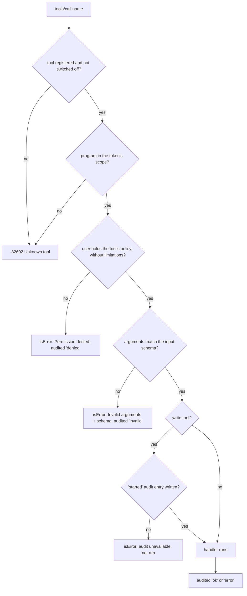

# Roles and the policy matrix

tron has no permission system of its own. Every tool, resource and prompt names one Exponential policy
(module/function); tron asks the kernel (`eZUser::hasAccessTo`) whether the calling user holds it. You grant tron's
functions in **Roles and policies** exactly like any other module's. Code: `modules/tron/module.php`,
`classes/kernel/tronkernelaccesschecker.php`, `classes/core/tronserver.php`.

## How a call is decided



**Visibility equals permission.** `tools/list`, `resources/list`, `resources/templates/list` and `prompts/list` show a
user exactly what that user may call, and every call is checked again whatever the client sends. Answers of the
kernel are cached for the life of one checker: one HTTP request, or one stdio process (restart the client after a role
change).

## The module tron

| Function | Opens |
|---|---|
| `use` | connecting at all, over either transport; `tron_whoami`, `tron_status`, `tron://status`, `tron://programs` |
| `admin` | Setup > tron: Dashboard, Programs and tools (with the switches), Settings; program origins and load times in `tron_status` |
| `tokens` | Setup > tron > Tokens: make, list and revoke every user's tokens |
| `audit` | Setup > tron > Audit: read the audit log, live tail |
| `centre_read` | the centre program's read tools, its resources and its prompts (tron's own tables) |
| `centre_write` | create, update, comment, move, close and link tickets |
| `centre_decide` | record a decision |
| `katalyst_read` | Katalyst services, plans and orders, with domains masked |
| `katalyst_detail` | full domains, and filtering services by domain |

Programs from other extensions name their own module/function pairs; they appear in Setup > tron > Programs and tools
with the roles that grant them.

## The matrix: tool by policy

### Program tron

| Tool / resource | Policy | Kind |
|---|---|---|
| `tron_whoami` | tron/use | read |
| `tron_status` | tron/use (origins and times only with tron/admin) | read |
| `tron://status`, `tron://programs` | tron/use | resource |

### Program centre, on tron's tables

| Tool / resource / prompt | Policy | Kind |
|---|---|---|
| `centre_ticket_list` | tron/centre_read | read |
| `centre_ticket_get` | tron/centre_read | read |
| `centre_board_view` | tron/centre_read | read |
| `centre_decision_review` | tron/centre_read | read |
| `centre_links_find` | tron/centre_read | read |
| `centre_ticket_create` | tron/centre_write | write |
| `centre_ticket_update` | tron/centre_write | write, idempotent |
| `centre_ticket_comment` | tron/centre_write | write |
| `centre_ticket_move` | tron/centre_write | write, idempotent |
| `centre_ticket_close` | tron/centre_write | write, idempotent |
| `centre_ticket_link` | tron/centre_write | write, idempotent |
| `centre_decision_record` | tron/centre_decide | write, idempotent |
| `centre://ticket/{id}`, `centre://board/{board}` | tron/centre_read | resource template |
| `centre_weekly_review`, `centre_triage` | tron/centre_read | prompt |

### Program centre, in front of the centre extension's API

Where the extension expcentre is in the installation (`[CentreSettings] Backend=auto` or `expcentre`), the 29
contract tools (`centre_whoami`, `centre_list_projects`, ... `centre_record_decision`, see [tools.md](tools.md)) need
`centre/api` in tron, and centre then checks its own policies on every card (`centre/board`, `card_read`,
`card_write`, `decide`, `manage`, with their Subtree limitations).

### Program katalyst

| Tool | Policy | Kind |
|---|---|---|
| `katalyst_plans_list` | tron/katalyst_read | read |
| `katalyst_services_list` | tron/katalyst_read; the `domain` filter and unmasked domains need tron/katalyst_detail | read |
| `katalyst_orders_list` | tron/katalyst_read | read |

## The matrix: role by tool

The suggested roles, and what each sees. "W" marks a write tool. The test suite checks this exact table for every role
(`tests/unit/PermissionMatrixTest.php`).

| Tool | Viewer | Editor | Decider | Operator | Operator (detail) | Use only |
|---|:-:|:-:|:-:|:-:|:-:|:-:|
| tron_whoami, tron_status | yes | yes | yes | yes | yes | yes |
| centre read tools (5) | yes | yes | yes | | | |
| centre write tools (6, W) | | yes | yes | | | |
| centre_decision_record (W) | | | yes | | | |
| katalyst lists (3) | | | | yes (masked) | yes (full) | |
| tools listed | 7 | 13 | 14 | 5 | 5 | 2 |

| Role | Policies |
|---|---|
| tron Viewer | tron/use, tron/centre_read |
| tron Editor | Viewer + tron/centre_write |
| tron Decider | Editor + tron/centre_decide |
| tron Operator | tron/use, tron/katalyst_read |
| tron Operator (detail) | Operator + tron/katalyst_detail |
| tron Administrator | tron/admin, tron/tokens, tron/audit (people who run tron, not agents) |
| AI session | tron/use plus exactly what that session needs |

A user with `*/*` (the kernel's Administrator role) holds every function, so an agent signed in as an administrator
sees every tool. Do not do that: make a dedicated user per agent with only the roles its work needs.

## Limitations

A policy granted **with limitations** (Section, Subtree, SiteAccess ...) comes back from the kernel as "limited". tron
treats it as **not granted**, unless the tool declares `limitedOk` and checks the limitation itself. No built-in tool
declares it, so grant tron's functions without limitations. This fails closed: a limitation can never be ignored by
accident.

## Combining roles

Roles add up, as everywhere in Exponential. An editor of web content who should also keep tickets gets both their
editing role and `tron Editor`. The kernel's Editor role holds no tron function: without `tron/use` the user cannot
connect at all.

## Scopes narrow, never widen

A token's scope ([tokens.md](tokens.md)) is checked before the policy. The effective set of tools is

```
tools listed = tools registered and switched on
             ∩ tools of programs in the token's scope (the core program always)
             ∩ tools whose policy the user holds without limitations
```

An administrator's token scoped to `centre` sees 14 tools: the two core tools and the twelve centre tools.

## Checking who may do what

| Question | How |
|---|---|
| What can this user's agent call? | sign in with a token of that user and call `tools/list`; or `tron.php call tron_status --user=<login>` |
| Which roles grant a tool? | Setup > tron > Programs and tools lists, for every tool, its policy and the roles that grant it, with links |
| What was refused? | `audit:tail`, or Setup > tron > Audit filtered by outcome `denied` |
| Did a role change take effect? | HTTP: from the next request. stdio: after the client restarts the server |

A policy simulator ("what could this token do?") is planned ([roadmap.md](roadmap.md)).

---

Copyright (C) 1998 - 2026 Exponential Foundation and 7x; All rights reserved. Licensed under the GNU General Public License v2.0 (or any later version).
