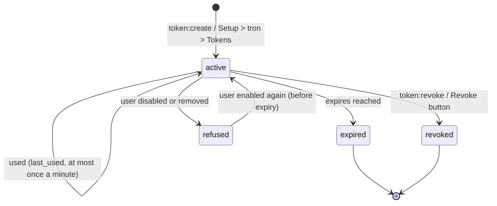

# Tokens: create, hand out, rotate, revoke, expire

A tron token stands for one Exponential user. It is the identity of every HTTP request and, where
`[StdioSettings] AllowLoginOption=disabled`, of every stdio server too. Code: `classes/core/trontokenservice.php`,
table `tron_token`.

## Anatomy

```
tron_Q2hxW0aZ1bKe_<43 characters of secret>
     \__________/ \_________________________/
      prefix (12)   secret: 256 random bits (random_int), URL-safe alphabet
```

| Part | Stored | Used for |
|---|---|---|
| prefix | in clear, unique | finding the row; shown in lists, the audit and Setup > tron; safe to share in a ticket |
| whole token | only as `sha256(token)` | the comparison, in constant time (`hash_equals`) |
| secret | never | |

A stolen copy of the table yields no usable token. The audit, the logs and every error message mask anything that
looks like a tron token (`tron_<prefix>_[redacted]`) or a bearer header.

## Row fields

| Field | Meaning |
|---|---|
| `user_id` | the user the token acts as |
| `name` | 1 to 100 characters: where it is used and what for (`claude@laptop`, `ci nightly`) |
| `scopes` | comma-separated program names, or `*` for all |
| `created`, `expires` | Unix times; `expires = created + days x 86400` |
| `last_used` | updated on a successful sign-in, at most once a minute per token |
| `revoked` | 0, or the time it was revoked |
| `created_by` | the administrator who made it in Setup > tron (0 from the command line) |

## Lifecycle



### Create

Command line:

```bash
php extension/tron/bin/php/tron.php token:create --siteaccess=<sa> --user=<login> \
    --name="claude@laptop" --days=30 --scopes=centre --out=/root/.config/tron/<login>-laptop.token
```

Administration: **Setup > tron > Tokens**, the form at the top (user, name, days, scopes). The token is shown once,
on the answer page, and never again. Making a token asks "Verify it's you" first (reauth group `tron`).

Rules checked on creation: the user exists and is enabled; the name has 1 to 100 characters; at least one day; at most
`[TokenSettings] MaxLifetimeDays` (365); scopes are program names (`^[a-z][a-z0-9]{1,31}$`) or `*`.

### Hand out

- **One token per agent and place.** One revoke then stops one agent; the audit tells them apart by token id.
- **Write it to a file, never into a configuration.** `--out` writes mode 0600 under a umask of 0077. Point the
  client at the file (`--token-file`) or load it into an environment variable when the session starts.
- **Never put a token in a URL**, a commit, a ticket or a chat message. tron accepts it only in the
  `Authorization: Bearer` header (HTTP), the `TRON_TOKEN` variable or a token file (stdio).
- **Keep tokens on the server for stdio over SSH.** The client needs only an SSH key; the token file stays on the node.

### Scope

`--scopes=centre,katalyst` limits a token to those programs. The core program `tron` (`tron_whoami`, `tron_status`)
is always in scope. A scope only narrows: the user's roles still decide, and a tool outside the scope looks like an
unknown tool to the client (it is not listed; calling it answers -32602).

Typical scopes:

| Agent | Scopes |
|---|---|
| a ticket assistant | `centre` |
| a hosting report job | `katalyst` |
| your own extension's agent | `<your program>` |
| a trusted maintenance session | all (no `--scopes`) |

### Use

Each request (HTTP) or each start (stdio) authenticates the token: the form, the prefix, the hash, not revoked, not
expired, the user present and enabled. A refusal answers 401 (HTTP) or stops `serve` with the reason on stderr; the
audit gets a row with method `auth`, outcome `unauthenticated`, the remote address and the prefix only.

### Rotate

**In the administration**: Setup > tron > Tokens, the Rotate button of a token. It makes a new token for the same user
with the same name, scopes and lifetime (capped at `MaxLifetimeDays`), shows it once, and revokes the old one in the
same step; an expired token can be renewed the same way. Use it when you can update the client right away. Rotating asks "Verify it's you", and the audit records it
(method `admin/token.rotate`, transport `admin`).

**From the command line**, rotation is create, switch, revoke. It keeps the old token working until the new one is
in place, and the audit shows the exact moment each was used.

```bash
# 1. a new token next to the old one
tron.php token:create --siteaccess=<sa> --user=<login> --name="claude@laptop (2026-12)" --days=30 \
    --scopes=centre --out=/root/.config/tron/<login>-laptop.token.new
# 2. switch the client (or move the file over the old one)
mv /root/.config/tron/<login>-laptop.token.new /root/.config/tron/<login>-laptop.token
# 3. check that the new one is used
tron.php token:list --siteaccess=<sa> --user=<login>          # the new token shows "last used"
# 4. revoke the old one by its prefix
tron.php token:revoke --siteaccess=<sa> <old prefix>
```

Rotate before expiry: `token:list` and Setup > tron > Tokens show each token's expiry and last use. A token nobody has
used for weeks is a candidate for revocation.

### Revoke

```bash
tron.php token:revoke --siteaccess=<sa> <id or prefix>
```

or the Revoke button in Setup > tron > Tokens (it asks "Verify it's you"; the audit records `admin/token.revoke`). HTTP refuses the token from the next
request. A **running stdio server** keeps the principal it started with: stop the client to end it. Revoked rows are
kept for the audit trail.

### Expire

A token stops working at `expires` without anyone acting. Defaults: `[TokenSettings] DefaultLifetimeDays=90`,
`MaxLifetimeDays=365`; lower both for stricter installations:

```ini
[TokenSettings]
DefaultLifetimeDays=30
MaxLifetimeDays=90
```

The limits apply when a token is made; tokens already made keep their expiry.

### Stop everything of one user at once

Disable the user in the administration (or remove the user). Every token of that user is refused from the next
request, without touching the tokens. Enabling the user again revives the tokens that have not expired or been
revoked.

## Emergency: a token leaked

1. Revoke it by prefix (the prefix is in the leaked text): `tron.php token:revoke --siteaccess=<sa> <prefix>`.
2. Read what it did: `tron.php audit:tail --siteaccess=<sa> --user=<login> --limit=500`, or the audit view filtered by
   user in Setup > tron. Refused sign-ins after the revoke show the remote addresses still trying.
3. If the user's other tokens may be affected, disable the user, then make fresh tokens.
4. Feed the file sink to fail2ban or your log shipping if attempts continue ([audit.md](audit.md)).

## Questions

**Can a user make their own tokens?** Not yet: tokens are made from the command line or by a user with `tron/tokens`
in Setup > tron. Self-service tokens on the account page are planned ([roadmap.md](roadmap.md)).

**Read-only tokens?** Give the token's user a role without write functions, or scope the token to programs that only
read. A per-token read-only flag is planned.

**Does a token carry the siteaccess?** No. A token belongs to the database it was made in; it works on every
siteaccess that uses that database and serves tron ([multi-site.md](multi-site.md)).

---

Copyright (C) 1998 - 2026 Exponential Foundation and 7x; All rights reserved. Licensed under the GNU General Public License v2.0 (or any later version).
